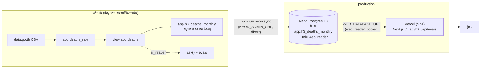

# Deploy: Vercel + Neon

ขึ้น production แค่ **แผนที่ 3 มิติ** (`web/`) ข้อมูลที่ขึ้นไปมีแค่ตารางสรุปจำนวนผู้เสียชีวิตต่อช่อง H3 ต่อเดือน
ข้อมูลรายคนทุกชนิดอยู่ในเครื่องนี้เท่านั้น

> สถานะ ณ 2026-11-06: Neon **ตั้งค่า โหลดข้อมูล และตรวจแล้วจริง** (`neon:sync`, `neon:check`) เว็บทดสอบกับ Neon ในเครื่องแล้ว
> แต่ **ยังไม่เคย deploy ขึ้น Vercel** ขั้นตอนข้อ 3 ด้านล่างยังไม่ได้ทำ และพฤติกรรมบน Vercel ที่ระบุว่า "ต้องตรวจหลัง deploy" ยังไม่ได้พิสูจน์

## 1. อะไรอยู่ที่ไหน



| | ในเครื่อง (Docker `roaddeaths-db`) | Neon (production) |
| --- | --- | --- |
| `app.deaths_raw`, view `app.deaths` | มี | **ไม่มี** |
| `app.h3_deaths_monthly` | มี | มี (คัดลอกด้วย `neon:sync`) |
| role `app_admin`, `ai_reader` | มี | **ไม่มี** |
| role `web_reader` | มี | มี (สร้างด้วย SQL จากไฟล์ `db/04_web_security.sql` ไฟล์เดียวกับในเครื่อง) |
| ตัวแปร `NEON_ADMIN_URL` | — | ใช้เฉพาะ `neon:sync` / `neon:check` ที่รันจากเครื่องนี้ **ไม่ขึ้น Vercel** |

### ทำไม production เก็บแค่ตารางสรุป

1. **ถ้าเว็บถูกเจาะ ผู้เจาะได้แค่ตารางสรุป** ไม่ใช่ข้อมูลรายคน ต่อให้ได้รหัสผ่านของ `web_reader` ไปด้วย ก็อ่านได้เท่าที่เว็บอ่านอยู่แล้ว
   (ช่อง + ปี + เดือน + จำนวน ไม่มีอายุ เพศ วันที่รายคน) ข้อมูลรายคนไม่ได้ "ถูกป้องกัน" ไว้บน Neon แต่ **ไม่เคยอยู่ที่นั่นเลย** ซึ่งแข็งแรงกว่ามาก
2. **ไม่มีหน้าที่ต้องใช้ข้อมูลรายคนบน production** แผนที่ใช้แค่ผลรวม ส่วน `ask()` ที่ต้องใช้ view `deaths` ยังไม่ได้ขึ้น production
   (ถ้าวันหนึ่งจะขึ้น ต้องตัดสินใหม่แยกต่างหาก ไม่ใช่เติมเข้ามาเงียบ ๆ)
3. **`neon:check` พิสูจน์ได้ว่ามีแค่นี้จริง** ข้อ 6 ของมันไล่ catalog ของ Neon ว่ามีตารางเดียว ไม่มี `app.deaths`/`deaths_raw` ไม่มี role `ai_reader`/`app_admin`
4. **ฐานข้อมูลฟรีของ Neon เล็ก** ตารางสรุปมี 7,194 แถว ไม่น่ากังวลเรื่องโควตาพื้นที่ (ส่วนโควตาชั่วโมงประมวลผล ดูข้อ 6)

## 2. ตั้งค่าครั้งแรก (ทำแล้วครั้งหนึ่งเมื่อ 2026-11-06)

ต้องมีใน `.env` (ไฟล์นี้ gitignore ไว้): `NEON_ADMIN_URL` = connection string ของ role เจ้าของฐานข้อมูลบน Neon แบบ **direct**
(host ไม่มี `-pooler`) สคริปต์จะหยุดถ้า host ชี้เครื่องตัวเอง, ผู้ใช้เป็น `web_reader`, หรือเป็น host แบบ pooled

```bash
npm run db:setup      # (ครั้งแรก) ฐานข้อมูลในเครื่องต้องมีตาราง H3 ก่อน
npm run neon:sync     # สร้าง schema/role/ตารางบน Neon แล้วคัดลอกแถว
npm run neon:check    # พิสูจน์สิทธิ์และเนื้อหาบน Neon ต้อง "ผ่านทุกข้อ"
```

`neon:sync` ทำอะไร (ทั้งหมดอยู่ใน transaction เดียว ผิดตรงไหน ROLLBACK ทั้งก้อน):

1. ตรวจ `NEON_ADMIN_URL` และอ่านตารางต้นทางในเครื่อง **ด้วย `web_reader` ของเครื่อง** (อ่านได้แค่ตารางสรุป ไม่ใช่แอดมิน)
2. ถ้าใน `.env` ยังไม่มี `NEON_WEB_DATABASE_URL` สุ่มรหัสผ่าน 32 ตัวแล้ว **ต่อท้าย** `.env` (ไม่แตะบรรทัดเดิม รักษา CRLF/LF เดิม ไม่ยอมเขียนถ้าไฟล์เป็น UTF-16
   และตรวจหลังเขียนว่าไบต์เดิมครบ) ค่าเป็น `postgresql://web_reader:<รหัส>@<host แบบ pooled>/<db>?sslmode=verify-full` ถ้ามีอยู่แล้วใช้ค่าเดิม
3. `CREATE SCHEMA IF NOT EXISTS app`, รัน `db/04_web_security.sql` แล้ว `db/05_h3_aggregate.sql` (ไม่รัน 01–03 และไม่แตะ `deaths`/`deaths_raw`)
   `04` สร้าง/อัปเดตรหัสผ่าน role ด้วย SQL (role ที่สร้างจาก console ของ Neon จะได้ CREATEROLE/CREATEDB ติดมา) แล้วจำกัดสิทธิ์
4. `TRUNCATE` แล้ว `INSERT` ทีละ 1,000 แถว
5. เทียบกับต้นทาง: จำนวนแถว, ผลรวม `death_count`, และ **digest md5 ของทุกแถว** (เรียงด้วย `COLLATE "C"` ทั้งสองฝั่ง) ไม่ตรง = ROLLBACK
6. หลัง COMMIT อ่านซ้ำจาก session ใหม่ เทียบอีกรอบ

รันซ้ำได้ ผลเหมือนเดิม (พิสูจน์แล้ว: รันสองรอบ ไฟล์ `.env` ขนาดเท่าเดิมรอบที่สอง ข้อมูลตรงกันทั้งสองรอบ)

> **Postgres 18:** ไฟล์ `04`/`05` ใช้แค่ `CREATE/ALTER ROLE`, `REVOKE/GRANT`, `ALTER DEFAULT PRIVILEGES`, `CREATE TABLE/INDEX IF NOT EXISTS` และบล็อก `DO` ซึ่งเป็น SQL มาตรฐาน
> ไม่ได้แก้ไฟล์ แล้วรันกับ Neon (Postgres 18.6) จริงสองรอบ ผ่านทั้งคู่ นั่นคือหลักฐานว่าใช้ได้กับ 18 (ฐานข้อมูลในเครื่องเป็น Postgres 17)

## 3. ตั้งค่า Vercel (ยังไม่ได้ทำ)

1. นำเข้า repo (private บน GitHub) เป็นโปรเจกต์ใหม่ใน Vercel
2. **Root Directory = `web`** Framework จะตรวจเจอเป็น Next.js เอง (`web/vercel.json` มีแค่ `regions`)
3. **Environment Variables** (Production) มีตัวเดียว:

   | ชื่อ | ค่า | หมายเหตุ |
   | --- | --- | --- |
   | `WEB_DATABASE_URL` | ค่าของ `NEON_WEB_DATABASE_URL` ใน `.env` | ติ๊ก Sensitive ผู้ใช้ใน URL ต้องเป็น `web_reader` ถ้าไม่ใช่ เว็บไม่ยอมทำงาน |

   คัดลอกค่าเข้าคลิปบอร์ดโดยไม่แสดงบนจอ (PowerShell/Git Bash บน Windows):

   ```bash
   node -e "const {parseEnv}=require('node:util');process.stdout.write(parseEnv(require('node:fs').readFileSync('.env','utf8')).NEON_WEB_DATABASE_URL)" | clip
   ```

   **ห้ามตั้ง `NEON_ADMIN_URL` บน Vercel** (และเว็บไม่รู้จักชื่อนี้เลย: `tests/web-db-config.test.ts` สแกน `web/` ว่าไม่มีคำว่า `NEON_`)
4. **Region = `sin1` (Singapore)** ตั้งไว้ใน `web/vercel.json` (`"regions": ["sin1"]`) ให้อยู่ใกล้ Neon `ap-southeast-1`
   ตรวจกับเอกสาร Vercel (อัปเดต 2026-08-11) แล้ว: `regions` ใน `vercel.json` เป็นรูปแบบที่รองรับ, `sin1` = `ap-southeast-1` Singapore,
   แผน Hobby ใช้ได้ภูมิภาคเดียว (เราใช้หนึ่ง) ถ้าเกินที่แผนอนุญาต deployment จะล้มก่อนขั้น build
   การตั้งนี้ **ไม่เกี่ยวกับเวอร์ชัน Next** เป็นของแพลตฟอร์ม และยัง **ไม่ได้พิสูจน์ด้วยการ deploy จริง**
5. Deploy

### ตรวจหลัง deploy (ต้องทำ — เรื่องเหล่านี้พิสูจน์ในเครื่องแล้วแต่ยังไม่เคยเห็นบน Vercel)

```bash
URL=https://<โดเมนของโปรเจกต์>
curl -s -o /dev/null -w "%{http_code}\n" "$URL/api/h3?res=8&year_from=2011&year_to=2024"      # ต้อง 200
curl -s -o /dev/null -w "%{http_code}\n" "$URL/api/years"                                      # ต้อง 200
curl -s -o /dev/null -w "%{http_code}\n" "$URL/api/h3?res=8&year_from=abc&year_to=2024"        # ต้อง 400
# ต้อง 400 ทั้งหมด: ถ้าได้ 200 แปลว่า proxy บน Vercel เห็น URL ที่ถูก normalize แล้ว ช่องหลบ cache ยังเปิดอยู่ (ดูข้อ 6)
curl -s -o /dev/null -w "%{http_code}\n" "$URL/api/h3?res=8&year_from=%32011&year_to=2024"
curl -s -o /dev/null -w "%{http_code}\n" "$URL/api/h3?res=8&year_from=2011&year_to=2024&cb=1"
# รอบที่สองของ URL มาตรฐานควรเป็น HIT (cache ทำงาน)
curl -s -D - -o /dev/null "$URL/api/years" | grep -i "x-vercel-cache"
```

แล้วเปิดหน้าเว็บ ดูว่าแผนที่ขึ้น มีตึก 3 มิติ และไทม์ไลน์ขึ้น (ไม่ใช่ข้อความ "ข้อมูลแผนที่ยังไม่พร้อม")

## 4. เปลี่ยนรหัสผ่านของ `web_reader`

สคริปต์ไม่เขียนทับค่าใน `.env` เอง (กันพลาด) ต้องลบบรรทัดก่อน:

1. เปิด `.env` ลบบรรทัด `NEON_WEB_DATABASE_URL=...` ทั้งบรรทัด (ลบทั้งบรรทัด ไม่ใช่ปล่อยให้ค่าว่าง: ถ้าคีย์ยังอยู่ `neon:sync` จะไม่ยอมต่อท้ายซ้ำ)
2. `npm run neon:sync` → สุ่มรหัสใหม่ ต่อท้าย `.env` แล้ว `ALTER ROLE` ให้ตรงกัน
3. `npm run neon:check` ต้องผ่านทุกข้อ
4. คัดลอกค่าใหม่ไปตั้ง `WEB_DATABASE_URL` บน Vercel (คำสั่งข้อ 3) แล้ว **Redeploy**

ระหว่างข้อ 2 ถึงข้อ 4 production ตอบ 503 (รหัสเดิมใช้ไม่ได้แล้ว) เพราะไม่มีกลไกให้สองรหัสใช้พร้อมกัน ทำต่อเนื่องในไม่กี่นาที
รหัสของ `NEON_ADMIN_URL`: reset ที่ console ของ Neon แล้วแก้ `.env` อย่างเดียว ไม่มีอะไรบน Vercel เปลี่ยน

## 5. sync ใหม่เมื่อข้อมูลเปลี่ยน

```bash
npm run db:load-h3      # สร้างตารางสรุปในเครื่องใหม่จากข้อมูลล่าสุด
npm run db:check        # ถ้าตัวเลขรวมเปลี่ยน จะล้ม → แก้ค่าคงที่ใน web/lib/dataset-facts.ts ให้ตรงก่อน
npm run neon:sync
npm run neon:check
```

แล้ว **ล้าง cache ของ Vercel** ด้วยการ Redeploy: คำตอบ 200 ถูก cache ที่ CDN 1 ชั่วโมง และส่งของเก่าได้อีกถึง 24 ชั่วโมงระหว่างรีเฟรช
(`stale-while-revalidate`) ถ้าไม่ Redeploy ผู้ชมอาจเห็นตัวเลขเก่า

ระหว่าง `TRUNCATE` (ไม่กี่วินาที) ตารางถูกล็อก คำขอที่ไม่ได้ติด cache รอได้สูงสุด 2 วินาที (`lock_timeout` ของ role) แล้วได้ 503 ทำตอนคนใช้น้อย

ค่าคงที่ที่ต้องแก้เมื่อข้อมูลเปลี่ยนจริง (ทั้งหมดอยู่ใน `web/lib/dataset-facts.ts` และถูกตรวจโดย `db:check`): `TOTAL_DEATHS`, `LOCATED_DEATHS`,
`LOCATED_DEATHS_COMPLETE_YEARS`, `TOTAL_DEATHS_BY_YEAR`

## 6. ปิดช่องหลบ cache ของ `/api/h3`

**ปัญหา:** CDN ใช้ URL ทั้งเส้นเป็นกุญแจ cache ถ้าเขียนคำถามเดียวกันได้หลายแบบ ใครก็สร้าง URL ใหม่ที่ cache ไม่เคยเห็นได้ไม่จำกัด
แต่ละอันทะลุไปถึงฐานข้อมูล บน Neon แผนฟรีนั่นคือโควตาชั่วโมงประมวลผลที่ถูกเผาได้ด้วย `curl` วนลูป (เปิดฐานข้อมูลที่หลับอยู่ขึ้นมาด้วย)

**สิ่งที่ prompt ระบุ:** "พารามิเตอร์ที่ไม่รู้จักต้องได้ 400" — `/api/h3` ทำอยู่แล้วก่อนงานนี้ (มี test) แต่ **ยังเหลือช่องอื่นที่วัดได้จริง:**

| วิธีหลบ | ตัวอย่าง | route เดิม | + ตรวจใน route อย่างเดียว | + `proxy.ts` |
| --- | --- | --- | --- | --- |
| สลับลำดับพารามิเตอร์ | `year_to=…&year_from=…&res=8` | 200 | 400 | 400 |
| ตัดค่าเริ่มต้นออก | `/api/h3`, `?res=8` | 200 | 400 | 400 |
| เติม `&` ท้ายหรือหน้า | `…&year_to=2024&`, `?&res=8…` | 200 | **200** | 400 |
| เข้ารหัสอักขระ | `year_from=%32011`, `r%65s=8` | 200 | **200** | 400 |
| `/api/years` ที่ถอดรหัสแล้วไม่มีพารามิเตอร์ | `?&` | 200 | **200** | 400 |

(คอลัมน์ "route เดิม" มาจากพฤติกรรมและ test เดิมของ route คอลัมน์ที่สองและสามวัดจริงกับ `next start` ด้วย `curl`/สคริปต์)

**วิธีแก้:** ยอมรับเฉพาะ query string รูปเดียว `res=<8|9>&year_from=<yyyy>&year_to=<yyyy>` ครบสามตัว เรียงตามนี้ ไม่เข้ารหัส (ที่เหลือได้ 400, `Cache-Control: no-store`)
ชุด URL ที่ถูกต้องจึงมี **2 × 105 = 210 เส้น** + `/api/years` 1 เส้น (test แจงครบทั้ง 210 และยืนยันว่าไม่ซ้ำกัน)

**ข้อค้นพบสำคัญ:** การตรวจใน route handler **อย่างเดียวไม่พอ** ผมเขียนมันก่อน แล้วทดสอบกับเซิร์ฟเวอร์จริง ปรากฏว่า `%32011` และ `&` เกินยังได้ 200
เพราะเมื่อคำขอมาถึง route แล้ว Next ถอดรหัสและเขียน query ขึ้นใหม่ไปแล้ว (route เห็นรูปมาตรฐานเสมอ) แก้โดย:

- ตรวจที่ **`web/proxy.ts`** (ชื่อใหม่ของ middleware ใน Next 16) ซึ่งรันก่อน cache และก่อน route ตรรกะอยู่ใน `web/lib/api-guard.ts` (ทดสอบแล้ว)
- เปิด **`skipProxyUrlNormalize: true`** ใน `web/next.config.ts` เพื่อให้ proxy เห็น URL ตามที่ส่งมาจริง (ตามเอกสาร Next: `request.url` เป็น URL ดิบ)
  มี test ตรวจว่าตัวเลือกนี้ยังอยู่ (ถ้าถูกลบ ช่องจะเปิดกลับโดยไม่มีใครรู้)
- route handler ยังตรวจซ้ำเป็นชั้นสำรอง

**วัดผลกับ `next start` จริง (ต่อ Neon):** 7 URL ที่ทดสอบ (ทุกแถวในตารางด้านบนและ `/api/h3` เปล่า ๆ) ได้ 400 หมด ส่วน URL มาตรฐานทั้ง 211 เส้นได้ 200 และ **ไบต์ต่อไบต์เหมือนกับ
เซิร์ฟเวอร์ที่ต่อฐานข้อมูลในเครื่อง** (ไฟล์ดิบอยู่ใน `docs/deploy-report.md`)

**ยังไม่ได้พิสูจน์:** พฤติกรรมของ proxy บน Vercel (ไม่เคย deploy) — ใช้คำสั่ง `curl` ชุดข้อ 3 ตรวจหลัง deploy ถ้า `%32011` ได้ 200 ให้ถือว่าช่องยังเปิด
**ที่ไม่ได้ทำ:** rate limit (ใช้ Vercel Firewall ได้) เพราะ 400 ที่ตอบจาก proxy ไม่แตะฐานข้อมูลแต่ยังนับเป็นการเรียกใช้ proxy/function

## 7. pooled กับ direct

| งาน | ใช้ | เหตุผล |
| --- | --- | --- |
| เว็บ (Vercel) | **pooled** (`-pooler`) | แต่ละคำขอบน serverless เปิด connection ใหม่ได้เร็ว PgBouncer แบบ transaction รับไหว |
| `neon:sync` (DDL, `TRUNCATE`, `set_config`) | **direct** | ต้องการ session ปกติ (สคริปต์ปฏิเสธ host แบบ pooled) |
| `neon:check` ส่วนแอดมิน (catalog) | direct | เหมือนกัน |
| `neon:check` ส่วน `web_reader` | pooled | ตรวจผ่านทางเดียวกับที่เว็บใช้จริง |

ค่าจำกัดของ `web_reader` (read-only, `statement_timeout 5s`, `search_path`) ตั้งที่ **ตัว role** (`ALTER ROLE ... SET`) จึงใช้ได้แม้ผ่าน pooler (`neon:check` ข้อ 2 ยืนยัน)

`neon:check` ลองเขียนอะไรก็ตามใน **transaction ที่ ROLLBACK เสมอ** และใช้ `BEGIN READ WRITE` แทนการ `SET default_transaction_read_only = off` ระดับ session
เพราะผ่าน PgBouncer ค่า session ที่ตั้งทิ้งไว้อาจค้างไปถึงผู้ใช้คนอื่นที่ได้ connection หลังเรา

`sslmode=verify-full` ใน `NEON_WEB_DATABASE_URL` ตามที่ pg รุ่นนี้แนะนำ (`require` จะอ่อนลงใน pg รุ่นหน้า) ไม่ใส่ `channel_binding` เพราะ pooler ไม่รองรับ

## 8. สิ่งที่ยังไม่ได้ทำ / ควรรู้

- **ยังไม่ได้ deploy** ขึ้น Vercel (ข้อ 3) และยังไม่ได้ตรวจพฤติกรรมบน Vercel (cache, proxy, region)
- `NEON_ADMIN_URL` ของคุณมี `sslmode=require` ทำให้ pg พิมพ์คำเตือนความปลอดภัยทุกครั้งที่รัน `neon:sync`/`neon:check` (ไม่พิมพ์ URL) แก้ได้ด้วยการเปลี่ยนเป็น
  `sslmode=verify-full` ใน `.env` เอง — ผมไม่ได้แก้เพราะไม่แตะค่าเดิมในไฟล์
- ไม่ได้ใช้ `attachDatabasePool` ของ `@vercel/functions` (คำแนะนำของ Neon skill สำหรับ `pg` บน Fluid compute) เพราะต้องเพิ่ม dependency ที่ prompt ไม่ได้ขอ
  pool ของเรา `max: 4` ผ่าน pooler และ `pg` ปิด connection ที่ว่างเองหลัง 10 วินาที ถ้าเห็น connection ค้างหลัง deploy ค่อยเพิ่ม
- **กฎซ่อน <3 ถูกอ้อมได้ด้วยการลบผลหลายคำขอ** (วัดแล้ว: 801 ช่อง-ปีที่ res9 ดู `docs/privacy.md`) พอเปิดสาธารณะ ช่องนี้เข้าถึงได้โดยใครก็ได้
  การจำกัดชุด URL เหลือ 210 เส้นไม่ได้ปิดมัน (ผู้โจมตีใช้ URL มาตรฐานที่ต้องการได้ครบ) แต่ข้อมูลต้นทางเปิดสาธารณะที่ data.go.th อยู่แล้ว
- เว็บเริ่มไม่ขึ้นถ้า `WEB_DATABASE_URL` ไม่ใช่ `web_reader`: `instrumentation.ts` โยน error ตอนเริ่ม ทุกคำขอได้ 500 เปล่า ๆ และไม่มีการเชื่อมต่อฐานข้อมูลเลย
  (บน `next start` โปรเซสยังรันอยู่แต่ตอบ 500 ทุกคำขอ ไม่ได้ปิดตัว บน Vercel คือทุก invocation ล้ม)

## 9. คำสั่งที่เกี่ยวข้อง

| คำสั่ง | ทำอะไร |
| --- | --- |
| `npm run neon:sync` | คัดลอกตารางสรุปขึ้น Neon (ข้อ 2) |
| `npm run neon:check` | พิสูจน์สิทธิ์และเนื้อหาบน Neon (exit 1 ถ้าข้อใดไม่ผ่าน) |
| `npm run web:neon -- build` | build เว็บ โดยส่ง `WEB_DATABASE_URL` จาก `NEON_WEB_DATABASE_URL` ทาง env ของ process (ไม่พิมพ์ค่า) |
| `npm run web:neon -- start 3011` | รันเว็บ production ในเครื่องโดยต่อ Neon |
| `npm run web:neon -- start-wrong-user 3013` | ทดสอบว่าเว็บไม่ยอมใช้ role อื่น (เปลี่ยนแค่ชื่อผู้ใช้ใน URL) |
