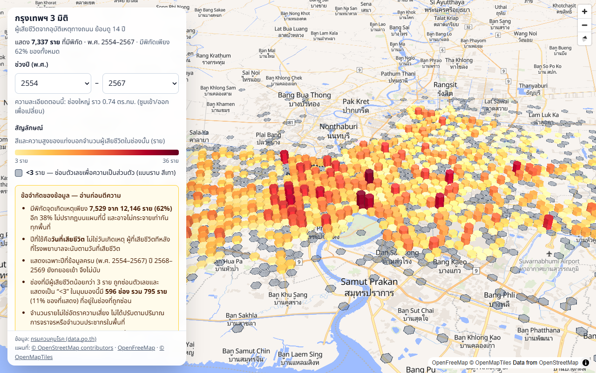
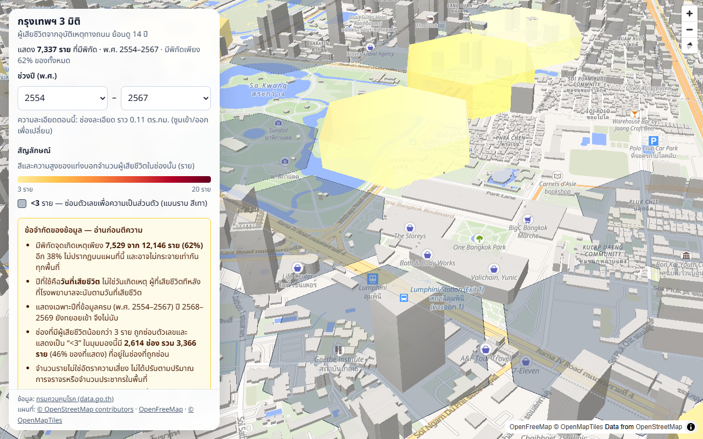
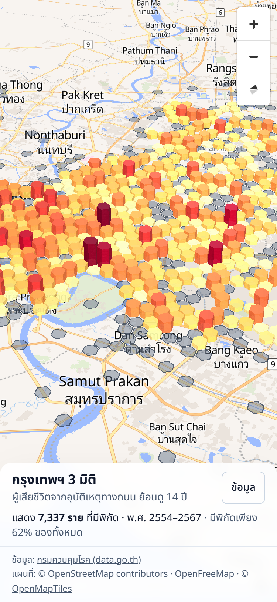
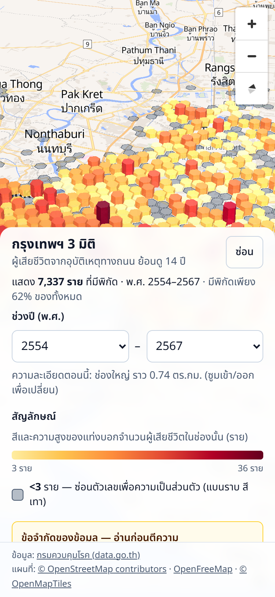
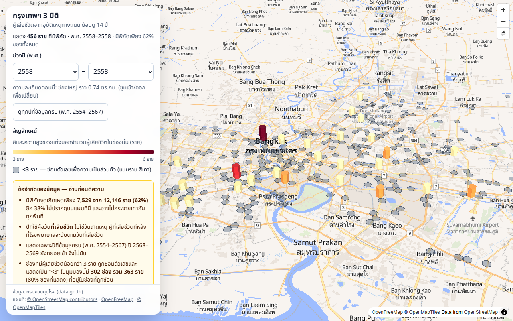
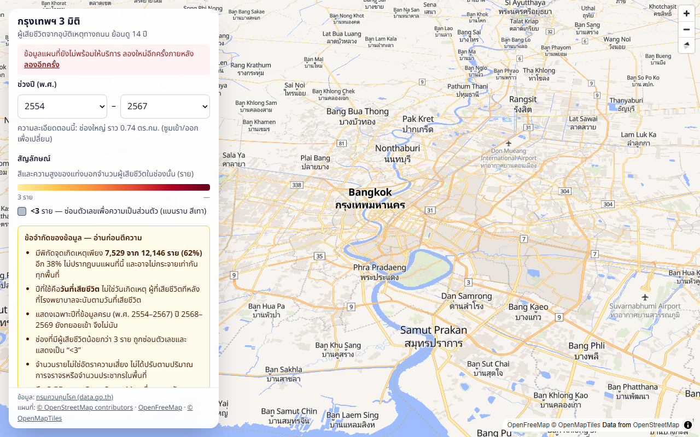

# รายงานงานเว็บ สัปดาห์ 1: กรุงเทพฯ 3 มิติ ย้อนดูอุบัติเหตุ

เขียนเมื่อ 5 พ.ย. 2569 · รอบที่สอง: ตรวจและต่อจากงานที่ agent ตัวก่อนทำค้างไว้ราว 40% โดยไม่เชื่อตามที่มันเขียน
ไม่มีการ commit, push, สร้าง remote หรือใช้ `gh` ไม่เรียก Claude API ไม่แก้ `questions.jsonl`, `crosscheck.py`, `src/grading.ts`, `src/sql-guard.ts`
ไม่ได้เปิดอ่านหรือแสดง `.env` (ที่รู้ว่า `WEB_DB_PASSWORD` ว่างมาจากข้อความของสคริปต์ `db:migrate` และ `db:check` เท่านั้น) ใช้เฉพาะ container `roaddeaths-db`

## 0. สรุปที่ต้องรู้ก่อนอ่านต่อ

1. **ช่องโหว่ทั้ง 4 ข้อแก้ครบ** พร้อม test (201 ข้อผ่าน เดิม 116) และหน้าแผนที่ทำงานจริงในเบราว์เซอร์ที่ 1280px และ 375px ไม่ล้นจอ
2. **สิ่งที่คุณต้องทำเอง:** `npm run db:migrate` ข้ามไฟล์ 04 โดยแจ้งว่า "ยังไม่ได้ตั้ง WEB_DB_PASSWORD" ทั้งที่คุณบอกว่าใส่แล้ว
   (อาจว่าง หรือยังไม่ได้ save ไฟล์ใน editor — ผมไม่เปิด `.env` จึงไม่รู้สาเหตุ) ผลคือ **role `web_reader` ยังไม่มีในฐานข้อมูลจริง**
   `npm run db:check` จึง **ล้ม** (ตั้งใจ — ดูข้อ 3 ข้อ ข) และเว็บจะไม่ขึ้น (ตั้งใจเช่นกัน) ขั้นตอนอยู่ที่ข้อ 7
3. **ทุกอย่างที่ต้องใช้ `web_reader` ผมทดสอบบนฐานข้อมูลชั่วคราว** (ใน container เดิม ด้วยรหัสผ่านสุ่มที่ไม่ถูกเขียนลงไฟล์ใดในโปรเจกต์ เก็บในโฟลเดอร์ชั่วคราวของ session แล้วลบทิ้ง)
   ข้อมูลเหมือนฐานข้อมูลจริงทุกตัวเลข แต่ **ยังไม่เคยรันเว็บกับ `web_reader` จริงของคุณ** (ข้อ 9)
4. ข้อค้นพบที่ไม่อยู่ในโจทย์แต่สำคัญ: กฎซ่อน <3 ราย **ถูกอ้อมได้** ด้วยการลบผลของหลายคำขอ (วัดแล้ว: กู้ได้ 801 ช่อง-ปีที่ res9) — ข้อ 5 และ `docs/privacy.md`
5. สิ่งที่รอบก่อนบอกว่าใช้ได้แต่จริงพัง: web build ไม่ผ่าน, แผนที่ไม่แสดงผลเลย (`maplibre-gl` 6 เข้ากันไม่ได้กับ deck.gl), `positron` ไม่มีตึก 3 มิติ,
   `db:check` "ผ่านทุกข้อ" ทั้งที่ข้ามการตรวจ `web_reader` เงียบ ๆ — ข้อ 4

## 1. ทำอะไรเสร็จ และอะไรยังไม่เสร็จ

| ข้อ | งาน | สถานะ |
| --- | --- | --- |
| 1ก | ลบ admin ออกจาก `web/` ไม่สลับ role ล้มตั้งแต่เริ่ม + test | ✅ เสร็จ |
| 1ข | API: ไม่ส่ง detail/role, ตารางไม่มี → 503, ตรวจปี → 400, ปี ค.ศ./พ.ศ. ตรงกันทั้งระบบ | ✅ เสร็จ |
| 1ค | ซ่อนช่อง <3 ทุกความละเอียดและทุกตัวกรอง, UI แสดง "<3", กล่องสรุปบอกจำนวนราย | ✅ เสร็จ |
| 1ง | ตรวจลำดับ migration 04→05 | ✅ ทดสอบบนฐานข้อมูลชั่วคราว 3 สถานการณ์ · ⬜ **ไม่ได้รัน `db:reset` จริง** (ขออนุญาตแล้ว คุณเลือกไม่รัน) |
| 2 | ขยาย `db:check` สำหรับ `web_reader` | ✅ เสร็จ (39 ข้อ ผ่านบนฐานข้อมูลชั่วคราว) · ⬜ **ยังไม่ผ่านบนฐานข้อมูลจริง** เพราะยังไม่มี role |
| 3 | หน้าแผนที่: MapLibre + deck.gl, ตึก 3 มิติ, ค่าเริ่มต้น 2554–2567, res8/res9 ตามซูม, กล่องข้อจำกัด, legend, attribution, ภาษาไทย, มือถือ 375px, พอร์ต 3010 | ✅ เสร็จ (ตรวจใน Chrome เท่านั้น — ข้อ 9) |
| 4 | test ใหม่ 4 กลุ่ม | ✅ เสร็จ ดูตารางด้านล่าง |
| 5 | `docs/privacy.md`, อัปเดต `docs/decisions-web.md` | ✅ เสร็จ |
| — | ตัวกรองรายเดือน, rate limit, ปิดช่องกู้ตัวเลขด้วยการลบ (noise/ตัวกรองตายตัว) | ⬜ ไม่ได้ทำ ไม่ได้ขอ (บันทึกเป็นงานค้างใน `docs/decisions-web.md`) |

**test ใหม่ (ข้อ 4)**

| ที่ขอ | อยู่ที่ |
| --- | --- |
| รวม H3: ผลรวมทุกช่อง = จำนวนแถวที่ส่งเข้าไป (ไม่ใช้ฐานข้อมูล) | `tests/h3-aggregate.test.ts` (จุดสุ่ม 2,000 จุด และกรณีช่อง res9 คร่อมขอบ res8) |
| ผลรวมในตาราง = 7,529 | `npm run db:check` (เทียบทั้งกับ `count(*) WHERE has_location` สดและกับ 7,529) |
| response มีแค่ `h3_index`, `count` หรือ `suppressed` ไม่มีพิกัด/role/error ภายใน | `tests/h3-api.test.ts` (ตรวจชุดฟิลด์ทั้งหมดและสแกนคำต้องห้าม) |
| ช่อง 1–2 รายต้องไม่ส่งตัวเลขจริง | `tests/h3-api.test.ts` |
| `web/lib/db.ts` ไม่สลับไปใช้ admin | `tests/web-db-config.test.ts` (วางรหัสผ่านแอดมินไว้ใน env ครบ แล้วยังต้อง error) และ test สแกนไฟล์ใน `web/` ว่าไม่มีคำต้องห้าม |

## 2. ผลของคำสั่งที่สั่งให้รัน

บรรทัดท้ายของ output คัดลอกมาจากไฟล์ที่เก็บไว้โดยตรง (สคริปต์ดึง ไม่ได้พิมพ์เอง) ตัดรหัสสีออกอย่างเดียว

### `npm test` (exit 0)

```text
> vitest run
 RUN  v5.1.0 D:/bangkok-road-deaths-chat
 Test Files  7 passed (7)
      Tests  201 passed (201)
   Start at  11:20:30
   Duration  503ms (import 43%, tests 30%, transform 23%, worker 4%)
```

### `npm run typecheck` (exit 0)

```text
> bangkok-road-deaths-chat@0.1.0 typecheck
> tsc --noEmit
```

### `npm run db:check` กับฐานข้อมูลจริง (exit 1) — **ล้ม ตามที่ตั้งใจ**

```text
       └ permission denied for function pg_sleep
การตรวจ role web_reader (ข้อบังคับ ข้ามไม่ได้)
──────────────────────────────────────────────────────────────────────────────
  FAIL เชื่อมต่อด้วย web_reader ไม่ได้ จึงพิสูจน์สิทธิ์ไม่ได้  (ไม่พบค่า WEB_DB_PASSWORD — คัดลอก .env.example เป็น .env แล้วเติมค่าให้ครบก่อน)
       └ ตั้ง WEB_DB_PASSWORD ใน .env แล้วรัน npm run db:migrate เพื่อสร้าง role ก่อน
──────────────────────────────────────────────────────────────────────────────
มี 1 ข้อไม่เป็นไปตามที่คาด
```

ล้มเพราะ `web_reader` ยังไม่ถูกสร้างในฐานข้อมูลจริง (ข้อ 0 ข้อ 2) ส่วนของ `ai_reader` ในรอบเดียวกันผ่านตามเดิม (13 ok, FAIL มี 1 รายการ คือบรรทัดด้านบน)
เวอร์ชันเก่าจะพิมพ์ "ข้าม" แล้วรายงาน "ผ่านทุกข้อ" ซึ่งทำให้เข้าใจผิดว่าตรวจแล้ว

### `npm run db:check` กับฐานข้อมูลชั่วคราวที่มี `web_reader` (exit 0)

ฐานข้อมูลนี้ถูกลบไปแล้ว ข้อมูลเหมือนฐานข้อมูลจริงทุกตัวเลข (12,146 ราย, 7,529 ราย มีพิกัด)

```text
       จำนวนแถว 7,194 · ช่อง res8 ที่ไม่ซ้ำ 1,458 · ช่อง res9 ที่ไม่ซ้ำ 3,572
  ok   ปีแรกในตาราง = 2011 ค.ศ. (DATA_YEAR_MIN)  (ได้ 2011)
  ok   ปีสุดท้ายที่ข้อมูลครบ = 2024 ค.ศ. (DATA_YEAR_MAX_COMPLETE)  (ได้ 2024)
  ok   is_complete_year ตรงกับช่วงปีในทุกแถว (ปี ≤ ปีสุดท้ายที่ครบ ⇔ ครบ)
  ok   ผลรวมของ query แบบ API (h3_res8) = ผู้เสียชีวิตที่มีพิกัดในปีที่ครบ  (7337 กับ 7337)
  ok   ผลรวมของ query แบบ API (h3_res9) = ผู้เสียชีวิตที่มีพิกัดในปีที่ครบ  (7337 กับ 7337)
──────────────────────────────────────────────────────────────────────────────
ผ่านทุกข้อ — ชั้นฐานข้อมูลทำงานตามที่ออกแบบไว้
```

### build ของ web (`cd web && npm run build`, exit 0) — รันโดยไม่มีรหัสผ่านฐานข้อมูลใด ๆ ใน environment

```text
Route (app)
┌ ○ /
├ ○ /_not-found
└ ƒ /api/h3
○  (Static)   prerendered as static content
ƒ  (Dynamic)  server-rendered on demand
```

### `curl` ไปที่ `/api/h3` สองครั้ง (production server `next start` พอร์ต 3010 เชื่อมฐานข้อมูลชั่วคราว)

```text
$ curl -s -i 'http://localhost:3010/api/h3'   (แสดงเฉพาะส่วนหัวและต้นเนื้อหา 300 ตัวอักษร)
HTTP/1.1 200 OK
vary: rsc, next-router-state-tree, next-router-prefetch, next-router-segment-prefetch
cache-control: public, max-age=300, s-maxage=3600, stale-while-revalidate=86400
content-type: application/json
x-content-type-options: nosniff

{"resolution":8,"year_from":2011,"year_to":2024,"k":3,"cells":[{"h3_index":"8864a4121bfffff","suppressed":true},{"h3_index":"8864a41243fffff","suppressed":true},{"h3_index":"8864a41289fffff","suppressed":true},{"h3_index":"8864a41291fffff","suppressed":true},{"h3_index":"8864a4129dfffff","suppressed


$ curl -s -i 'http://localhost:3010/api/h3?year_from=abc'
HTTP/1.1 400 Bad Request
vary: rsc, next-router-state-tree, next-router-prefetch, next-router-segment-prefetch
cache-control: no-store
content-type: application/json
x-content-type-options: nosniff

{"error":"invalid_parameter","message":"year_from must be a 4-digit integer year in the Common Era (CE), e.g. 2011"}
```

เนื้อหาของคำตอบแรกยาวกว่านี้ (1,450 ช่อง) ตัดให้เห็นแค่ส่วนต้น ผมตรวจทั้งก้อนด้วย regex แล้วว่าไม่มี `lat|lng|lon|role|web_reader|detail|error|password|postgres` (0 รายการ ทั้ง res8 และ res9)
คำขออื่นที่ลองเพิ่ม: `year_from=2567` (พ.ศ.), `year_to=2025`, `year_from=2020&year_to=2015`, `res=7`, `foo=1`, `year_from` ซ้ำ ได้ 400 ทุกข้อ

## 3. ช่องโหว่ 4 ข้อแก้อย่างไร

**ก) `web/lib/db.ts` สลับไปใช้ admin เมื่อไม่มีรหัสผ่าน**

- เขียนไฟล์ใหม่ทั้งไฟล์ ไม่มี `adminPool`, `getActivePool` หรือฟังก์ชันสลับ role เหลืออยู่ (export ได้แค่ `assertWebConfig` และ `getWebPool`)
- ตรรกะค่าตั้งอยู่ที่ `web/lib/web-config.ts` (ฟังก์ชันล้วน): ไม่มีรหัสผ่านของ `web_reader` → `throw` ชื่อ role ตรึงเป็น `web_reader` ใส่ role อื่นใน `WEB_DB_USER` หรือ `WEB_DATABASE_URL` ไม่ได้
- `web/instrumentation.ts` เรียกตรวจตอนเริ่มเซิร์ฟเวอร์ (ข้ามตอน `next build`) ทดสอบจริง: `next dev` ไม่ใส่รหัสผ่าน → ปิดตัว (curl ต่อไม่ได้),
  `next start` ไม่ใส่รหัสผ่าน → ทุกคำขอได้ `500 Internal Server Error` เปล่า ๆ ไม่มีรายละเอียดรั่ว
- หลังเชื่อมต่อตรวจซ้ำว่าเป็น `web_reader` จริงและไม่มีสิทธิ์พิเศษ (superuser, createrole, createdb, replication, bypassrls)
- **ไม่ใช้ `POSTGRES_USER`/`POSTGRES_PASSWORD` เลย** และไม่โหลด `.env` ทั้งไฟล์เข้า process.env ของเว็บ (รอบก่อนโหลดทั้งไฟล์ ทำให้รหัสผ่านแอดมินและ API key อยู่ในหน่วยความจำของเว็บ)
  อ่านเฉพาะ 6 ตัวแปรที่อนุญาต (`web/lib/local-env.ts`) มี test สแกนทุกไฟล์ใน `web/` ว่าไม่มีคำเหล่านี้แม้ในคอมเมนต์
- test: `tests/web-db-config.test.ts`

**ข) `/api/h3`**

- ลบ `detail` และ `role` ออกจาก response; error ส่งข้อความกลาง ๆ (`The map data is temporarily unavailable.`) รายละเอียดจริงไป `console.error` ฝั่งเซิร์ฟเวอร์
- ตารางยังไม่มี → **503** ไม่ใช่ 200 ว่าง ทดสอบกับฐานข้อมูลจริงที่ไม่มีตาราง: ได้ `503` และ `no-store` ส่วนข้อความ `relation "app.h3_deaths_monthly" does not exist` อยู่ใน log เท่านั้น
  ผลว่างสำหรับช่วงปีที่ถูกต้องก็ตอบ 503 เช่นกัน (ช่วงที่ผ่านการตรวจมีผู้เสียชีวิตทุกปีแน่นอน ผลว่างแปลว่าตารางยังไม่ได้โหลด)
- `year_from`/`year_to`: ต้องเป็นตัวเลข 4 หลักในช่อง 2011–2024 และ `year_from ≤ year_to` ไม่ใช่ → **400** (`year_from=abc` ดูผล curl ด้านบน)
  เพิ่มเติม: `res` ต้องเป็น 8 หรือ 9, พารามิเตอร์ซ้ำหรือไม่รู้จักถูกปฏิเสธ (กัน URL สุ่มหลบ cache ไปโดนฐานข้อมูล) ข้อความ 400 ไม่สะท้อนค่าที่ผู้ใช้ส่ง
- **ปี:** ตรวจกับฐานข้อมูลจริงว่าตารางเป็น **ค.ศ.** (`year_be = died_year + 543` ทุกแถวทุกปี) API รับ ค.ศ. (ส่ง พ.ศ. ได้ 400 พร้อมข้อความบอก) หน้าเว็บแปลงเป็น พ.ศ. ที่จุดแสดงผลจุดเดียว
  ค่าคงที่อยู่ที่ `web/lib/years.ts` และ `db:check` เทียบกับตารางจริง
- แก้ build ที่พัง: ลบ `export const dynamic = 'force-dynamic'` เพราะ `cacheComponents` ไม่อนุญาต

**ค) ซ่อนช่อง <3 ราย**

- API: ช่องที่ `count < 3` ส่งเป็น `{"h3_index": "...", "suppressed": true}` ไม่มีฟิลด์ `count` ใช้กับทุกความละเอียดและทุกช่วงปี (ตัดสินจากยอดหลังกรอง)
- เรียงช่องตามรหัสช่อง ไม่ใช่ตามจำนวน (ไม่งั้นตำแหน่งบอกว่าเป็น 1 หรือ 2 ราย)
- หน้าเว็บ: ช่องที่ซ่อนเป็นหกเหลี่ยมสีเทาแบนราบ tooltip "<3 ราย (ซ่อนตัวเลขเพื่อความเป็นส่วนตัว)" legend อธิบาย "<3" กล่องข้อจำกัดบอกจำนวนช่องและจำนวนราย
  (เช่นช่วงเริ่มต้น res8: "596 ช่อง รวม 795 ราย (11% ของที่แสดง)")

**ง) ลำดับ migration**

ทดสอบบนฐานข้อมูลชั่วคราวใน `roaddeaths-db` (ตรวจก่อนว่าสคริปต์ชี้ไปฐานข้อมูลชั่วคราวจริง) 3 สถานการณ์ `db:check` ผ่านทุกครั้ง **ไม่ต้องแก้ SQL**

1. ฐานข้อมูลเปล่า → `db:setup` ทั้งชุด
2. ตารางมีอยู่ก่อน role (ตรงกับฐานข้อมูลจริงของคุณตอนนี้) → ใส่รหัสผ่านแล้ว `db:migrate`
3. `db:migrate` ซ้ำ

ไม่ได้รัน `db:reset` จริง: ขออนุญาตตามที่ตกลงแล้ว คุณเลือก "ไม่รัน" ส่วนที่ไม่ครอบคลุมคือการสร้าง Docker volume ใหม่ ซึ่งไม่เกี่ยวกับสิทธิ์
สิ่งที่ผมทำกับฐานข้อมูลจริง: รัน `db:migrate` หนึ่งครั้ง (ซ้ำได้ ไม่เปลี่ยนอะไรเพราะ 04 ถูกข้าม) และ `db:load-h3` หนึ่งครั้ง (โหลดตารางสรุปใหม่ ได้ผลเหมือนเดิมทุกแถว: 7,194 แถว ผลรวม 7,529)

## 4. สิ่งที่พบเพิ่มระหว่างตรวจ (นอกเหนือจาก 4 ข้อ)

| พบ | ผล | ทำอย่างไร |
| --- | --- | --- |
| `db:check` ข้าม `web_reader` เงียบ ๆ แล้วรายงาน "ผ่านทุกข้อ" | ความมั่นใจปลอม | ทำเป็นข้อบังคับ ไม่มี role/รหัสผ่าน = ล้ม; ไล่ตรวจทุกตารางใน schema `app` จาก catalog; ลองเขียนแม้หลังปิด read-only |
| **บั๊กรวม H3:** รวมกลุ่มด้วย res9 แล้วใช้ res8 ของจุดแรกกับทั้งกลุ่ม แต่ H3 ไม่ซ้อนกันสนิท | ผู้เสียชีวิตติดขอบนับผิดช่อง res8 โดยผลรวมยังถูก (ตรวจด้วยผลรวมไม่เจอ) | พิสูจน์ด้วย test (ล้มก่อนแก้ `expected 2 to be 1`) แก้ที่ `src/h3-aggregate.ts` **ผลกับข้อมูลจริง: ไม่มี** โหลดใหม่ได้ตารางเหมือนเดิมทุกประการ |
| `maplibre-gl@^6.16.0` เข้ากันไม่ได้กับ deck.gl 9.4.1 (`map.transform` หายไป) | แผนที่ไม่แสดงผลเลย มีแต่แผง | ลดเป็น `^5.24.0` พิสูจน์ด้วย stack trace และดูผลในเบราว์เซอร์ |
| `positron` ไม่มีชั้น `fill-extrusion` เลย (liberty มี 1) | ไม่มีตึก 3 มิติ | ใช้ `liberty` (ข้อ 6) |
| CSS ของ maplibre ตั้ง `position: relative` ชนะ `absolute` ของ Tailwind v4 | container แผนที่สูง 0px (วัดได้ 1280×0) | ครอบสองชั้น |
| ตัวเลขประมาณการผิดเยอะ (res8 ไม่ใช่ 100–200 ช่อง แต่ 1,458 ฯลฯ) | เหตุผลของการเลือก k และความละเอียดผิดทิศ | แก้ใน `docs/decisions-web.md` ตารางข้อ ก |
| `npm install` ใน `web/` รื้อโครงสร้าง (เพิ่ม 183 ลบ 216) เพราะ `workspaces` ที่รากไม่ได้ผูกจริง | เสี่ยงทำ `node_modules` พัง | ไม่แก้โครงสร้าง ใช้ `--prefix "$(pwd)" --workspaces=false` และบันทึกคำเตือน (ข้อ 11) |
| ปุ่มซูมของ MapLibre สูง 29px | ต่ำกว่าเกณฑ์แตะ 44px | ขยายด้วย CSS บนจอสัมผัส |

## 5. จำนวนช่องที่ถูกซ่อนและจำนวนรายในช่องเหล่านั้น

ช่วงเริ่มต้น พ.ศ. 2554–2567 (เฉพาะปีที่ข้อมูลครบ รวม 7,337 ราย) ผลจาก API จริง:

| ความละเอียด | ช่องที่มีผู้เสียชีวิต | **ช่องที่ถูกซ่อน** | **ผู้เสียชีวิตในช่องที่ถูกซ่อน** |
| --- | --: | --: | --: |
| **res8** | 1,450 | **596** (41.1%) | **795 ราย** (10.8%) |
| **res9** | 3,527 | **2,614** (74.1%) | **3,366 ราย** (45.9%) |

ตัวอย่างเมื่อกรองเหลือปีเดียว (พ.ศ. 2563): res8 ซ่อน 384 จาก 407 ช่อง (458 จาก 545 ราย = 84.0%), res9 ซ่อน 472 จาก 478 ช่อง (521 จาก 545 ราย = 95.6%)

หมายเหตุ: จำนวนช่อง res8 ในช่วงปีที่ครบ (1,450) น้อยกว่าที่ตาราง (1,458) เพราะอีก 8 ช่องมีผู้เสียชีวิตเฉพาะในปี 2568–2569 ที่ยังไม่ครบ

เอาต์พุตของ `npm run web:measure-suppression` (รันซ้ำได้เมื่อเปิดเว็บอยู่) รวมการวัดว่ากฎนี้ถูกอ้อมได้แค่ไหน:

```text
> bangkok-road-deaths-chat@0.1.0 web:measure-suppression
> tsx src/scripts/measure-suppression.ts

API: http://localhost:3010

1) สัดส่วนที่ถูกซ่อน
  res8 ทุกปีที่ข้อมูลครบ      ช่อง  1450 ซ่อน   596 (41.1%) · ผู้เสียชีวิต  7337 ในช่องที่ซ่อน   795 (10.8%)
  res9 ทุกปีที่ข้อมูลครบ      ช่อง  3527 ซ่อน  2614 (74.1%) · ผู้เสียชีวิต  7337 ในช่องที่ซ่อน  3366 (45.9%)
  res8 ปีเดียว (ค.ศ. 2020)    ช่อง   407 ซ่อน   384 (94.3%) · ผู้เสียชีวิต   545 ในช่องที่ซ่อน   458 (84.0%)
  res9 ปีเดียว (ค.ศ. 2020)    ช่อง   478 ซ่อน   472 (98.7%) · ผู้เสียชีวิต   545 ในช่องที่ซ่อน   521 (95.6%)

2) กู้ตัวเลขที่ควรถูกซ่อนด้วยการลบผลของสองคำขอ
  res8: กู้ได้ 2180 รายการช่อง-ปี ว่า "ปีนั้นช่องนี้มี 1 หรือ 2 ราย" (ใช้ 14 คำขอ)
  res9: กู้ได้ 801 รายการช่อง-ปี ว่า "ปีนั้นช่องนี้มี 1 หรือ 2 ราย" (ใช้ 14 คำขอ)
```

ข้อ 2 ของผลนี้คือสิ่งที่ต้องบอกผู้สัมภาษณ์ตรง ๆ: **กฎ <3 เป็นกฎแสดงผล ไม่ใช่การรับประกัน** (ดู `docs/privacy.md` หัวข้อ "สิ่งที่ยังกันไม่ได้")

## 6. แผนที่พื้นหลัง และเงื่อนไขการอ้างอิง

- **ใช้:** OpenFreeMap style **Liberty** `https://tiles.openfreemap.org/styles/liberty` (ไม่ต้องใช้ token) แทน Positron ที่รอบก่อนเลือก
- **ตรวจแล้วว่ามีชั้นตึกพร้อมความสูงจริง:** Liberty มี `building-3d` (fill-extrusion, ความสูงจาก `render_height`, เริ่มที่ซูม 14) Positron และ Bright ไม่มีชั้น fill-extrusion เลย (0)
  ถอดรหัส vector tile ซูม 14 จริง 7 จุดในกรุงเทพฯ: ใจกลางเมือง (สยาม 149 หลัง, สีลม 286 หลัง) มีความสูงจริง เพียง 1–2% เป็นค่าเริ่มต้น 5 ม. ตึกสูงสุด 315 ม.
- **ข้อจำกัดที่ต้องบอก:** ชานเมืองมีตึกใน OSM น้อยมาก (tile สายไหม 2 หลัง, หนองจอก 4, บางขุนเทียน 4, ลาดกระบัง 17) ซึ่งตรงกับย่านที่มีผู้เสียชีวิตมาก
  แท่งหกเหลี่ยมที่นั่นจึงลอยเหนือพื้นที่ที่ตึกยังว่าง (เขียนไว้ในกล่องข้อจำกัดบนหน้าเว็บแล้ว) ตัวอย่าง 7 จุดเป็นการสุ่มเลือกจุดที่รู้จัก ไม่ใช่การสุ่มทั้งเมือง
- **เงื่อนไขการอ้างอิง (อ่านจาก tilejson ของ OpenFreeMap):** `OpenFreeMap © OpenMapTiles Data from OpenStreetMap` แสดงสองที่: ตัวควบคุม attribution ของ MapLibre ที่มุมขวาล่างของแผนที่
  และบรรทัดถาวรท้ายแผงข้อมูล (ไม่ถูกซ่อนแม้พับแผงบนมือถือ) พร้อมลิงก์ไป openstreetmap.org/copyright, openfreemap.org, openmaptiles.org และลิงก์แหล่งข้อมูล data.go.th
- ความเสี่ยง: เป็นบริการของบุคคลที่สามที่ไม่มี SLA ถ้าโหลดไม่ขึ้นใน 20 วินาที หน้าเว็บแจ้งผู้ใช้ ไม่ปล่อยให้เห็นจอว่าง

## 7. วิธีเปิดดูหน้าเว็บในเครื่อง

ฐานข้อมูลจริงของคุณตอนนี้ยังเปิดดูไม่ได้ ต้องทำก่อน:

1. เปิด `.env` ตรวจว่ามีบรรทัด `WEB_DB_PASSWORD=<รหัสผ่านที่คุณตั้ง>` และ **บันทึกไฟล์แล้ว** (migrate ล่าสุดอ่านแล้วได้ค่าว่าง) ชื่อผู้ใช้ `WEB_DB_USER=web_reader` ไม่ต้องใส่ก็ได้
2. `npm run db:up` (ถ้า Postgres ยังไม่ขึ้น) แล้ว `npm run db:migrate` — บรรทัด `04_web_security.sql … ok` ต้องไม่ใช่ "ข้าม"
3. `npm run db:check` ต้องจบด้วย **ผ่านทุกข้อ** (ส่วน web_reader ผ่านครบ)
4. `npm run web:dev` แล้วเปิด **http://localhost:3010** (พอร์ต 3000 ถูกโปรเจกต์อื่นใช้) หรือ `cd web && npm run dev`

ใช้งาน: เลื่อน/หมุน/เอียงแผนที่ได้ ซูมเข้าเกินระดับ 12.5 จะสลับเป็นช่องละเอียด (res9) และซูมถึง 14 ขึ้นไปจึงเห็นตึก 3 มิติ เลือกช่วงปี (พ.ศ.) ที่แผงด้านซ้าย (มือถือ: ปุ่ม "ข้อมูล")
ถ้าไม่มีรหัสผ่าน เว็บจะไม่ขึ้นโดยตั้งใจ (dev: ปิดตัว, production: ตอบ 500)

## 8. ภาพหน้าจอ

ถ่ายจาก production server ด้วย Chrome แบบ headless (WebGL แบบซอฟต์แวร์) ข้อมูลจากฐานข้อมูลชั่วคราวที่ตัวเลขเหมือนฐานข้อมูลจริง

| | |
| --- | --- |
|  ค่าเริ่มต้น พ.ศ. 2554–2567 |  ซูมเข้า: res9 และตึก 3 มิติ |
|  มือถือ 375px (พับแผง) |  มือถือ 375px (เปิดแผง) |
|  กรองเหลือปีเดียว: เกือบทั้งหมดถูกซ่อน |  API ล้ม: ไม่มีแท่ง ไม่มีตัวเลข มีปุ่มลองอีกครั้ง |

การวัดจากเบราว์เซอร์ (ไม่ใช่คาดเดา): ที่ 1280px และ 375px `scrollWidth` เท่ากับความกว้างหน้าจอ ไม่มีองค์ประกอบเลยขอบ ทั้งตอนพับและเปิดแผง ปุ่ม/ช่องเลือกบนมือถือสูง 44px ทุกตัว
ฟอนต์ Noto Sans Thai โหลดจริง เปลี่ยนช่วงปีแล้วคำขอ API ถูกต้อง (ช่วงปีไม่เคยกลับด้าน) และเมื่อ API ตอบ 503, 400 หรือเน็ตหลุด หน้าเว็บแสดงข้อความ + ปุ่มลองอีกครั้ง ไม่แสดงตัวเลขใด

## 9. สิ่งที่ตรวจไม่ได้ และข้อจำกัดของการตรวจ

- **ยังไม่เคยรันเว็บกับ `web_reader` จริงในฐานข้อมูลจริงของคุณ** (ต้องรอ `WEB_DB_PASSWORD`) ที่ทดสอบคือฐานข้อมูลชั่วคราวที่ตั้งด้วย `POSTGRES_DB` ชั่วคราว ข้อมูลและสคริปต์เดียวกัน
- **ไม่ได้รัน `db:reset` จริง** ตามที่คุณเลือก
- **เบราว์เซอร์:** Chrome เท่านั้น แบบ headless ที่ใช้ WebGL ซอฟต์แวร์ (SwiftShader) จอมือถือเป็นการจำลองขนาด 375×812 ไม่ใช่เครื่องจริง ไม่ได้ลอง Safari/Firefox
  ไม่ได้วัดความลื่นบน GPU หรือมือถือจริง (ข้อมูลต่อครั้งสูงสุดราว 3,500 ช่องที่ res9 น่าจะไหว แต่ยังไม่ได้พิสูจน์)
- ตึก 3 มิติ: วัดจาก 7 tile ที่เลือกเอง ไม่ใช่ทั้งเมือง
- ตัวเลขช่องที่ซ่อนและการกู้ตัวเลขด้วยการลบ วัดผ่าน API จริงของ production server แล้ว แต่เป็นข้อมูลชุดนี้ชุดเดียว (ถ้าข้อมูลเปลี่ยน ตัวเลขเปลี่ยน)
- ไม่ได้ประเมินด้านกฎหมาย (PDPA) ของการเผยแพร่แผนที่นี้

## 10. ไฟล์ที่สร้างหรือแก้

**สร้างใหม่ในรอบนี้**

- โค้ดเว็บ: `web/lib/years.ts`, `web/lib/dataset-facts.ts`, `web/lib/web-config.ts`, `web/lib/local-env.ts`, `web/lib/h3-api.ts`, `web/lib/h3-queries.ts`, `web/lib/h3-client.ts`,
  `web/instrumentation.ts`, `web/components/MapApp.tsx`, `web/components/MapCanvas.tsx`, `web/components/InfoPanel.tsx`, `web/components/mapConfig.ts`
- โค้ดราก: `src/h3-aggregate.ts`, `src/scripts/measure-suppression.ts`
- test: `tests/h3-aggregate.test.ts`, `tests/h3-api.test.ts`, `tests/h3-client.test.ts`, `tests/web-db-config.test.ts`
- เอกสาร: `docs/privacy.md`, `docs/web-week1-report.md` (ไฟล์นี้), `docs/screenshots/` (6 ภาพ)

**เขียนใหม่หรือแก้ในรอบนี้**

- `web/lib/db.ts` (เขียนใหม่), `web/app/api/h3/route.ts` (เขียนใหม่), `web/app/page.tsx`, `web/app/layout.tsx`, `web/app/globals.css`, `web/README.md`,
  `web/package.json` (เพิ่มสคริปต์ `typecheck`, `maplibre-gl` `^6.16.0` → `^5.24.0`), `web/package-lock.json`
- `src/scripts/load-h3.ts` (ใช้ `aggregateH3`, ตรวจผลรวมกับ view ที่นับสด), `src/scripts/check-db-security.ts` (ชุดตรวจ web_reader แบบบังคับ), `src/lib/db.ts` (`WEB_DB_USER` มีค่าเริ่มต้น `web_reader`)
- `package.json` ที่ราก (เพิ่มสคริปต์ `web:dev`, `web:build`, `web:measure-suppression`), `.env.example`, `docs/decisions-web.md` (เขียนใหม่), `docs/security.md` (เพิ่มหัวข้อ role ที่สาม), `README.md` (เพิ่มส่วนหน้าเว็บ)

**ของ agent ก่อนหน้าที่ตรวจแล้วและไม่ได้แก้:** `db/04_web_security.sql`, `db/05_h3_aggregate.sql` (ผ่านการทดสอบลำดับแล้ว), `src/scripts/migrate.ts`, `src/lib/env.ts`,
`web/next.config.ts`, `web/tsconfig.json`, และรายการ `workspaces`/`h3-js` ใน `package.json` กับ `package-lock.json` ที่ราก (ยืนยันด้วย md5 ว่าไม่ถูกแตะตอนติดตั้ง maplibre)

ทั้งหมดยังไม่ commit (ตามที่สั่ง)

## 11. ข้อสังเกตนอกขอบเขต (ไม่ได้แก้)

- **`workspaces` ที่ราก** ประกาศ `["web"]` แต่ `web/` มี lockfile และ `node_modules` ของตัวเอง และ lockfile ที่รากไม่มี `web` ตัวอย่างอันตราย: `npm install <แพ็กเกจ>` ใน `web/` ตรง ๆ จะรื้อโครงสร้าง
  ควรเลือกอย่างใดอย่างหนึ่ง (workspace จริง หรือแยกโปรเจกต์) ก่อนสัปดาห์ 3 ที่เว็บจะเรียก `ask()` จาก `src/`
- **ตารางสถานะใน `README.md`** (สัปดาห์ 1 จาก 4, "ยังไม่มีส่วน AI และหน้าเว็บ") ล้าสมัยแล้ว ผมเพิ่มส่วนหน้าเว็บ แต่ไม่ได้แก้ตารางสถานะเพราะไม่ได้ตรวจสถานะของงานอื่น
- `maplibre-gl` ล็อกที่ 5.x จนกว่า deck.gl จะรองรับ 6.x อย่าอัปเกรดตามอัตโนมัติ
- `web/public/*.svg` เป็นของตัวอย่าง Next.js ที่ไม่ได้ใช้ ปล่อยไว้ (ลบได้)
